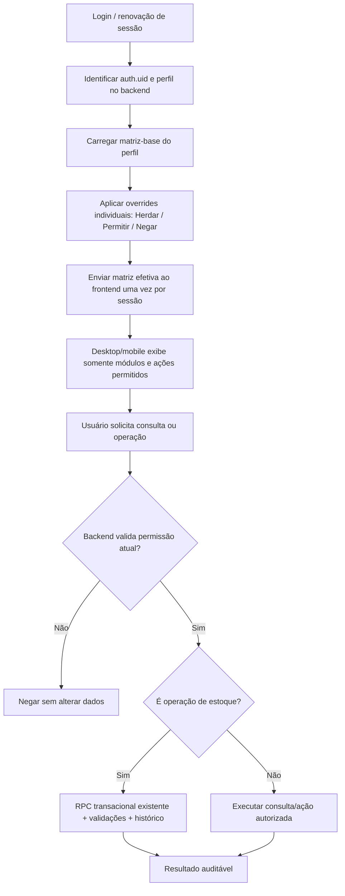

# Matriz de Permissões — Endereçamento (v1.2)

**Status:** regras funcionais consolidadas. O alinhamento final de leitura, Pesquisa e Realtime está sendo implementado no clone local; produção permanece bloqueada até a validação integrada de frontend, RLS/RPC e rollback.

## 1. Decisões consolidadas

- **Administrador:** acesso total, único responsável por alterar permissões e gerir usuários. Proteção do último administrador permanece obrigatória.
- **Apoio:** perfil operacional dos estoquistas. Pode pesquisar, lançar, transferir, processar lotes, consultar histórico/divergências e usar o Consultor. Pode ver o mapa físico, mas não corrigir saldo nem editar o mapa por padrão. Exportação e capacidades de edição/correção podem ser concedidas individualmente pelo Administrador a pessoas de confiança.
- **Produção:** perfil de consulta restrita a pesquisa de produto/endereço, filtros, exportação somente dos resultados acessíveis e Consultor IA. Sem lançamentos, histórico completo, mapa, cadastro, resolução de divergências ou gestão por padrão.
- **Visualizador:** leitura ampla de telas operacionais, Dashboard, histórico, divergências, produtos/Base e mapa/estrutura em leitura, além de filtros, exportação e Consultor IA. Não pode executar operações ou administrar usuários/permissões.
- **Liderança:** perfil configurável disponível para atribuição pelo Administrador. `stock.search` é permitido por padrão para manter a leitura operacional completa; as outras 28 permissões continuam negadas inicialmente e podem ser configuradas pelo Administrador nas chaves delegáveis. As chaves exclusivas do Administrador continuam bloqueadas.
- **Exceções por usuário:** o Administrador pode configurar cada permissão como **Herdar / Permitir / Negar**. Sem exceção, vale a matriz do perfil; Permitir/Negar prevalece sobre a base, exceto chaves exclusivas do Administrador listadas abaixo. Só o Administrador pode gerenciar permissões.
- **Exportação:** uma permissão única para PDF, Excel, CSV e outros formatos. Exportar exige simultaneamente `reports.export` e acesso de leitura aos dados/tela; o botão nunca amplia o conjunto de dados permitido.
- **Frontend e backend:** desktop/mobile usam a mesma matriz efetiva. RLS/RPC/Edge Function validam no backend; ocultar uma aba não é segurança.
- **Estoque crítico:** movimentação, lote, transferência, correção física e resolução de divergência continuam pelos fluxos transacionais atuais, com histórico e validações. Não abrir gravações diretas para contornar autorização.

## 2. Matriz-base por perfil

Legenda: **Permitido** = liberado como padrão do perfil; **Negado** = bloqueado como padrão. As exceções individuais aplicáveis podem alterar o padrão somente quando a coluna de delegação permitir.

| Permissão | Administrador | Apoio | Produção | Visualizador | Liderança | Exceção por usuário? |
|---|---:|---:|---:|---:|---|
| `dashboard.view` — Dashboard — consultar indicadores | Permitido | Negado | Negado | Permitido | Negado | Sim |
| `stock.search` — Pesquisa de SKU, descrição e endereço (leitura completa dos 14 campos) | Permitido | Permitido | Permitido | Permitido | Permitido | Sim |
| `stock.details.view` — Detalhes operacionais de saldo/posição | Permitido | Permitido | Negado | Permitido | Negado | Sim |
| `stock.launch.view` — Abrir tela de lançamentos sem autorizar gravação | Permitido | Permitido | Negado | Permitido | Negado | Sim |
| `stock.launch.create` — Lançamento normal de entrada/saída | Permitido | Permitido | Negado | Negado | Negado | Sim |
| `stock.transfer.create` — Transferência entre posições | Permitido | Permitido | Negado | Negado | Negado | Sim |
| `stock.batch.process` — Processamento de lote compartilhado | Permitido | Permitido | Negado | Negado | Negado | Sim |
| `stock.physical_correction` — Correção física de SKU/saldo pelo mapa | Permitido | Negado | Negado | Negado | Negado | Sim |
| `history.view` — Consultar histórico de movimentações | Permitido | Permitido | Negado | Permitido | Negado | Sim |
| `divergences.view` — Consultar divergências | Permitido | Permitido | Negado | Permitido | Negado | Sim |
| `divergences.resolve` — Resolver/tratar divergências | Permitido | Permitido | Negado | Negado | Negado | Sim |
| `products.view` — Abrir catálogo/Base de produtos e SKUs | Permitido | Negado | Negado | Permitido | Negado | Sim |
| `products.create` — Cadastrar SKU individual | Permitido | Negado | Negado | Negado | Negado | Sim |
| `products.edit` — Editar cadastro de SKU individual | Permitido | Negado | Negado | Negado | Negado | Sim |
| `products.import_bulk` — Importar/atualizar base em lote | Permitido | Negado | Negado | Negado | Negado | Não — Admin exclusivo |
| `products.delete_deactivate` — Excluir/desativar SKU | Permitido | Negado | Negado | Negado | Negado | Não — Admin exclusivo |
| `map.view` — Visualizar mapa físico/gêmeo digital | Permitido | Permitido | Negado | Permitido | Negado | Sim |
| `map.metadata.edit` — Editar metadados do mapa sem corrigir saldo | Permitido | Negado | Negado | Negado | Negado | Sim |
| `warehouse.layout.view` — Consultar estrutura física do estoque | Permitido | Negado | Negado | Permitido | Negado | Sim |
| `warehouse.layout.manage` — Criar/editar/ativar/desativar/remover posições ou módulos | Permitido | Negado | Negado | Negado | Negado | Não — Admin exclusivo |
| `consultor.use` — Usar Consultor de Estoque/IA | Permitido | Permitido | Permitido | Permitido | Negado | Sim |
| `reports.export` — Exportar dados/relatórios em qualquer formato | Permitido | Negado | Permitido | Permitido | Negado | Sim |
| `database.view` — Abrir Base de Dados em leitura | Permitido | Negado | Negado | Permitido | Negado | Sim |
| `database.manage` — Manutenção geral da Base de Dados | Permitido | Negado | Negado | Negado | Negado | Não — Admin exclusivo |
| `users.view` — Consultar lista/gestão de usuários | Permitido | Negado | Negado | Negado | Negado | Não — Admin exclusivo |
| `users.manage` — Criar/alterar/desativar/excluir usuários | Permitido | Negado | Negado | Negado | Negado | Não — Admin exclusivo |
| `permissions.manage` — Administrar permissões de perfis e usuários | Permitido | Negado | Negado | Negado | Negado | Não — Admin exclusivo |
| `configuration.view` — Consultar configurações em modo somente leitura | Permitido | Negado | Negado | Permitido | Negado | Sim, somente leitura |
| `configuration.manage` — Alterar configurações administrativas | Permitido | Negado | Negado | Negado | Negado | Não — Admin exclusivo |

## 3. Regras de prioridade e limites

1. A decisão efetiva para uma chave delegável é: **override individual `Permitir/Negar` → se inexistente, regra-base do perfil**.
2. Usuário/perfil desconhecido, chave desconhecida, permissão ausente ou erro ao carregar a matriz resulta em **negado para ações protegidas**. Não existe fallback para acesso total.
3. Estas permissões permanecem **exclusivas do Administrador e não podem ser concedidas por override**: `users.view`, `users.manage`, `permissions.manage`, `configuration.manage`, `database.manage`, `products.import_bulk`, `products.delete_deactivate` e `warehouse.layout.manage`.
4. `dashboard.view` é delegável individualmente, apesar de negado por padrão a Apoio e Produção. `products.create` e `products.edit` são ações separadas e podem ser concedidas individualmente para delegar cadastro/correção de SKU sem conceder importação em lote ou exclusão.
5. `map.view`, `map.metadata.edit`, `stock.physical_correction` e `warehouse.layout.manage` são permissões distintas. Visualizar o mapa nunca concede edição, correção de saldo ou alteração da estrutura física.
6. **Mudança de perfil do usuário:** recomendação de segurança: redefinir os overrides comuns desse usuário para `Herdar` e exigir que o Administrador reaprove as exceções necessárias. Isso evita que alguém mantenha uma permissão elevada depois de mudar de função.
7. Mudança de permissão não usa Realtime nem polling. A interface recarrega as permissões ao entrar/renovar sessão ou após atualizar o app. O backend lê a decisão vigente a cada operação protegida, portanto uma revogação não depende de o navegador ter atualizado a tela.
8. A autorização é conferida dentro da consulta/RPC/RLS já usada sempre que possível. Não criar uma Edge Function por clique ou por operação de estoque.

## 4. Fluxo de autorização

A matriz enviada ao frontend serve para a interface, não substitui a validação no backend. A função de autorização deve ser única, indexada e testada para não executar leituras repetidas desnecessárias. A permissão `dashboard.view` deve liberar indicadores consolidados, não SELECT irrestrito das linhas completas de estoque.

## 5. Modelo técnico recomendado (ainda sem SQL)

- `permission_catalog`: catálogo fixo e versionado de chaves, com descrição, grupo, risco e indicação de se a chave pode ser delegada.
- `role_permissions`: permissão-base por perfil e chave, com valor explícito permitido/negado.
- `user_permission_overrides`: uma linha por usuário/chave com estado `allow` ou `deny`; ausência da linha significa herdar o perfil.
- `permission_change_audit`: um evento por salvamento administrativo, contendo autor, data/hora, usuário/perfil afetado e antes/depois das permissões alteradas. Um salvamento em lote gera um evento consolidado, não um evento por renderização/checkbox.
- `get_my_permissions`: uma única chamada de leitura por sessão para devolver a matriz efetiva ao frontend.
- `has_app_permission`: helper do banco/RLS/RPC para validar a chave atual. Deve usar `auth.uid()`, schema qualificado, `search_path` seguro, privilégios explícitos e índices nas chaves de busca.
- Uma RPC administrativa em lote para salvar alterações de permissões em uma transação e gravar a auditoria. Validar que o chamador é Administrador; a tabela de permissões não recebe escrita direta pelo usuário comum.
- A Edge Function `admin-users` permanece somente nos fluxos de gestão de usuários que realmente precisam dela. Não chamar Edge Function por operação normal nem por cada checagem de permissão.

## 6. Estimativa de carga — Supabase Free

**Limitação da análise:** o arquivo de observações menciona screenshots de Realtime e Edge Functions, mas os gráficos não estão embutidos no arquivo recebido. Portanto, a tabela abaixo é projeção de novas chamadas da arquitetura proposta, não medição do consumo atual da conta.

### Premissas para estimativa

- 22 dias úteis/mês.
- Uma leitura consolidada de permissões por sessão/login; carregamento normal não consulta cada chave individualmente.
- Sem polling e sem canal Realtime novo.
- Checagem das ações ocorre dentro da chamada RPC/RLS já necessária para aquela ação, sem Edge Function adicional.
- Para mostrar sensibilidade, são mostrados cenários de uma e duas sessões por usuário/dia. Recargas manuais/renovações acrescentam uma leitura cada.

| Cenário | Leituras de permissões/mês | Edge Functions adicionais para permissões | Mensagens Realtime adicionais |
|---|---:|---:|---:|
| 10 usuários × 1 sessão/dia | 220 | 0 | 0 |
| 10 usuários × 2 sessões/dia | 440 | 0 | 0 |
| 30 usuários × 1 sessão/dia | 660 | 0 | 0 |
| 30 usuários × 2 sessões/dia | 1.320 | 0 | 0 |

As leituras acima são chamadas de API/banco, não invocações de Edge Function. Uma alteração administrativa de várias permissões deve ser salva em lote, em uma RPC, e gerar um único evento de auditoria por salvamento. O volume das operações operacionais atuais permanece separado e não aumenta por causa de uma Edge Function extra.

A documentação oficial consultada indica para o plano Free: **500.000 invocações de Edge Functions/mês**, **2 milhões de mensagens Realtime/mês** e **200 conexões simultâneas de pico**. A proposta acrescenta zero invocações de Edge Function e zero mensagens Realtime para autorização rotineira. Isso não permite concluir qual é a folga real do projeto porque os screenshots de uso não foram recebidos.

Fontes oficiais consultadas em 28/10/2026:
- https://supabase.com/docs/guides/platform/billing-on-supabase
- https://supabase.com/docs/guides/realtime/limits
- https://supabase.com/docs/guides/platform/manage-your-usage/edge-function-invocations

### Como comprovar tempo/carga antes da produção

1. Criar testes com banco local/cópia de teste e o catálogo pequeno de permissões.
2. Medir login/carregamento com 10 e 30 sessões simuladas; verificar número de requests no navegador e duração p50/p95.
3. Testar consultas RLS e RPCs com permissão permitida e negada, garantindo que a função auxiliar usa índices e não faz leitura completa de tabelas.
4. Testar falha de carregamento e perfil desconhecido: negar acesso, retornar erro compreensível e não repetir automaticamente em loop.
5. Executar teste de rajada de negações. Não gravar um log por tentativa; usar deduplicação/agregação limitada para impedir que erros repetidos encham logs/tabelas. Auditar integralmente as alterações de permissões administrativas, não cada renderização ou leitura.
6. Antes da publicação, comparar screenshots reais de uso do Supabase com as quotas atuais e medir o tempo real em staging/teste. Nenhuma garantia de performance é inferida apenas do tamanho da matriz.

## 7. Plano de implantação e rollback (futuro, obrigatório)

1. **Preflight somente leitura:** exportar usuários/perfis, matriz atual, políticas RLS e definições das RPCs/Edge Functions relevantes. Confirmar as cinco funções ativas, as 29 chaves e as 145 linhas de matriz; verificar que `stock.search` está permitido para Liderança e as outras 28 permissões-base permanecem negadas.
2. **Snapshot versionado:** guardar as definições anteriores e checksums/versões dos artefatos usados no deploy. Não usar apenas a versão do código como rollback do banco.
3. **Migração expansiva:** adicionar catálogo/tabelas/helper sem apagar políticas antigas no primeiro passo; popular apenas com a matriz aprovada; verificar contagens e integridade.
4. **Teste em ambiente isolado:** todos os perfis, overrides, chamadas diretas, falhas seguras e operações de estoque transacionais. Não usar mutações de teste em produção.
5. **Ativação coordenada:** a matriz no banco, as proteções RLS/RPC e o frontend precisam ser ativados como pacote; o frontend sozinho não fecha a brecha de chamada direta.
6. **Rollback pronto antes de executar:** script reverso revisado que restaura exatamente as definições anteriores de RLS/RPC e desativa o uso da nova autorização. Manter as novas tabelas de configuração durante o rollback inicial em vez de apagá-las automaticamente, preservando configurações/auditoria. Só remover objetos novos em uma migração posterior, após confirmação de que não são necessários.
7. **Verificações pós-implantação:** testar as operações mais críticas e confirmar que saldos/histórico não foram modificados pelo rollout. Se qualquer verificação falhar, reverter o backend para as definições versionadas anteriores e publicar a versão de frontend anterior.
8. **Sem publicação até aprovação explícita.** Este documento não autoriza DDL, alteração de RLS ou deploy.

## 8. Testes de aceite exigidos

- Cada uma das 5 matrizes-base ativas, incluindo Liderança com `stock.search` permitido e as outras 28 permissões inicialmente negadas.
- Cada permissão positiva e negativa: interface, API/RLS, RPC e Edge Function quando aplicável.
- Override `Herdar`, `Permitir`, `Negar`; configuração da matriz-base de Liderança; mudança de perfil; revogação; sessão desatualizada; falha de rede; chave desconhecida.
- Usuário comum tentando alterar a própria matriz; sempre negado.
- Tentativa de conceder chaves exclusivas do Administrador; sempre bloqueada pelo backend.
- Último Administrador não perde acesso e não pode ser removido/rebaixado sem proteção equivalente aprovada.
- Apoio sem override não exporta, não corrige saldo e não edita mapa; usuário escolhido com override pode executar exatamente a ação concedida e nenhuma outra.
- Exportação limitada às telas/dados legíveis mesmo quando `reports.export` está permitido.
- Lançamento, transferência, lote, correção física e resolução de divergência continuam atômicos, auditáveis e idempotentes.
- Desktop/mobile mostram os mesmos direitos de negócio.
- Zero polling, zero canal Realtime novo, zero Edge Function por operação rotineira, sem loops de retry ou tempestade de logs.
- `lint`, build e todos os testes de regressão passam.

## 9. Ponto de validação final

Esta matriz usa as suas respostas como regras-base: o Visualizador vê as áreas do sistema em leitura, inclusive configurações não secretas em modo somente leitura; os controles de alteração continuam exclusivos do Administrador. A interface de configuração precisará ocultar/desabilitar ações de escrita e nunca exibir segredos, credenciais ou chaves. Somente o Administrador gerencia usuários e permissões.

**Estado da matriz:** regras funcionais consolidadas. A publicação exige a validação conjunta de frontend, RLS/RPC e rollback; não autoriza por si só qualquer DDL ou deploy em produção.

## 10. Ajuste v1.2 — separação entre visualizar e executar lançamentos

Foi adicionada a chave `stock.launch.view` porque o requisito funcional permite ao Visualizador acessar o sistema para acompanhar o fluxo, mas não executar lançamentos. Essa chave controla apenas a entrada/visualização da tela. A criação de entradas/saídas continua protegida por `stock.launch.create`, e transferência/lote continuam com chaves próprias. Esta adição é do catálogo e dos testes; não altera a autorização da aplicação atual até a implementação completa e migração aprovada.

## 11. Observação de liberação — leitura de dados

A leitura de `slots` é concedida como um escopo completo: `stock.search` autoriza os registros com as 14 colunas; não existe permissão por coluna. Desktop e Mobile preservam suas apresentações próprias, e os filtros são locais sobre a base compartilhada. `stock.details.view` permanece como chave legada sem efeito sobre a leitura ou a apresentação. `reports.export` é independente: a Pesquisa exige `reports.export` + `stock.search` e Excel/PDF usam uma projeção operacional fixa de 12 campos, sem ID técnico, respeitando os filtros ativos. A política de SELECT de `slots` deve depender somente de `stock.search`; a política de `divergencias` somente de `divergences.view`, separada de `divergences.resolve`. O Realtime de estoque é compartilhado nas áreas que consomem `slots`; o Realtime de divergências exige `divergences.view`. Operações críticas ficam bloqueadas quando a fotografia não está integralmente sincronizada e dependem das RPCs atômicas como última validação.

## 12. Dependências efetivas entre leitura e operações

- `stock.search` é a permissão-base dos módulos que consomem a fotografia completa de `slots`. Negar essa permissão também torna inefetivos Dashboard, Pesquisa, Lançamentos, Mapa, Base, Estrutura, Consultor e Divergências que dependam dessa base.
- A leitura de divergências exige `divergences.view` e `stock.search`. `divergences.resolve` não substitui a leitura.
- Lançamento, transferência, lote, correção física e resolução de divergências exigem sua permissão de operação, a leitura `stock.search` e `divergences.view`, pois os fluxos atuais validam snapshots de estoque e divergências antes da RPC atômica.
- Essas dependências são aplicadas tanto no `has_app_permission` (backend/RLS/RPC) quanto no `get_my_app_context` (interface), sem novas chamadas de rede, canais Realtime ou Edge Functions.
- `history.view` e permissões administrativas não ganham dependências artificiais de `stock.search` quando não consomem a base operacional atual.

## 13. Renovação de sessão e revogação de acesso Realtime

O Supabase calcula e mantém em cache a autorização RLS do Postgres Changes durante a conexão WebSocket. Uma revogação feita no banco não encerra instantaneamente um canal já conectado: a política é reavaliada quando o cliente reconecta ou envia um JWT novo. O SDK Supabase envia o novo token ao Realtime em `TOKEN_REFRESHED`; o aplicativo recarrega `get_my_app_context` no mesmo evento para atualizar também a interface. Não há canal de permissões nem polling adicional.

As consultas PostgREST e as RPCs protegidas continuam validando a permissão atual no banco, independentemente do estado antigo da interface. Para o Realtime, a revogação passa a valer quando o novo JWT é aplicado ou a assinatura é reestabelecida. Portanto, a implantação deve validar a duração real do JWT configurado no projeto e documentar essa janela; não prometer revogação instantânea de um WebSocket já conectado.
